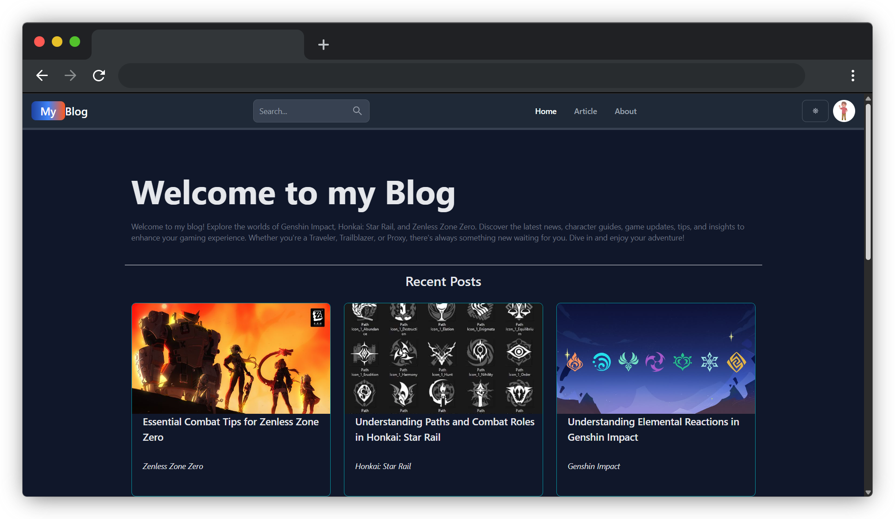
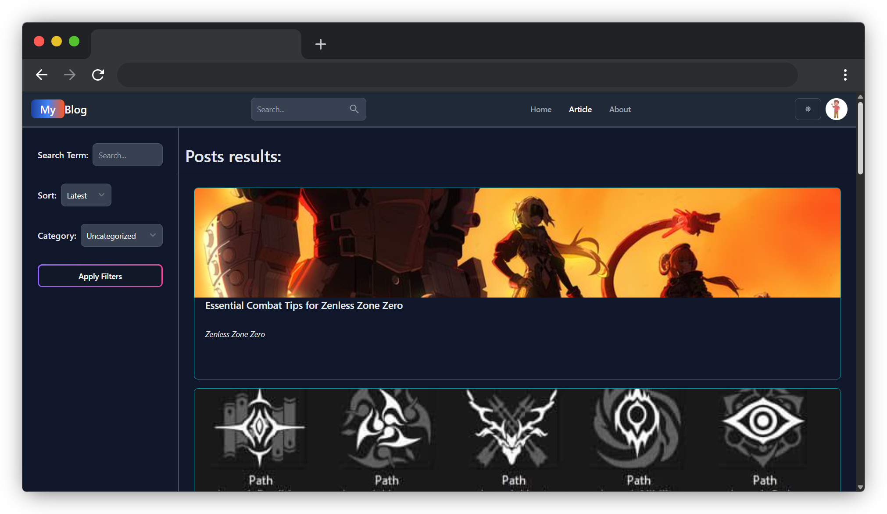
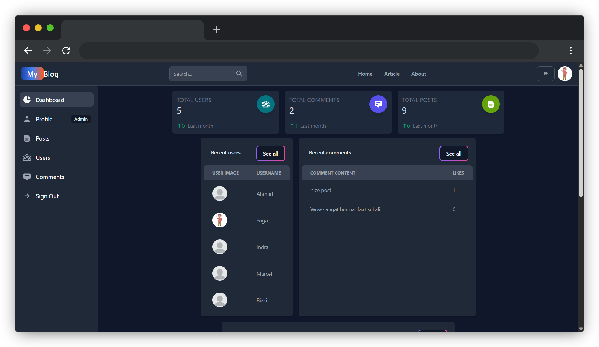
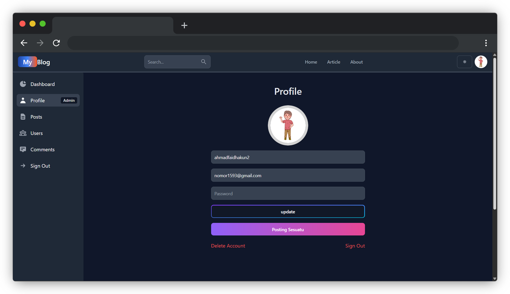
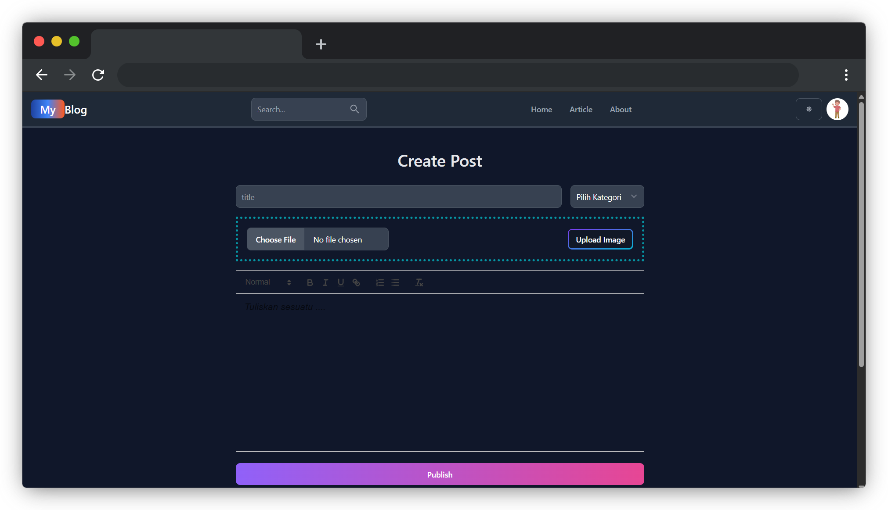
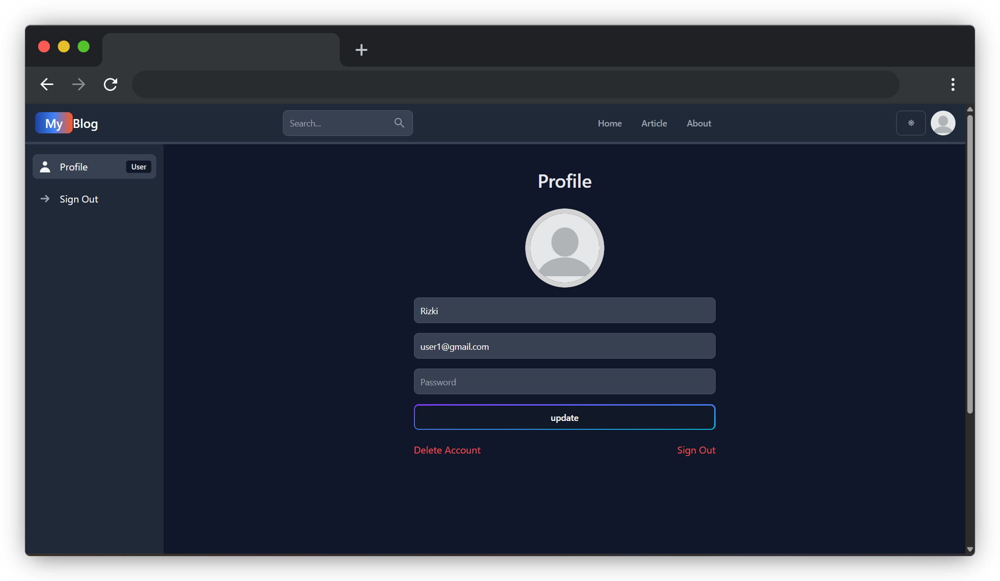

# My Blog Platform

A web-based gaming blog platform dedicated to Genshin Impact, Honkai: Star Rail, and Zenless Zone Zero. It allows users to explore gaming articles, discover guides and updates, and interact with other readers through comments.


**Built with:** React.js · Express.js · Node.js · MongoDB · REST API · Firebase Authentication · Firebase Object Storage

---

## Application Preview

Explore the main interfaces of the My Blog.

<table>
  <tr>
    <td width="50%">
      
      <p align="center"><strong>Home Page</strong></p>
    </td>
    <td width="50%">
      
      <p align="center"><strong>Search Page</strong></p>
    </td>
  </tr>
  <tr>
    <td width="50%">
      
      <p align="center"><strong>Dashboard Admin</strong></p>
    </td>
    <td width="50%">
      
      <p align="center"><strong>Admin Profile Page</strong></p>
    </td>
  </tr>
  <tr>
    <td width="50%">
      
      <p align="center"><strong>Create Post Page</strong></p>
    </td>
    <td width="50%">
      
      <p align="center"><strong>User Profile Page</strong></p>
    </td>
  </tr>
</table>

## About The Project

**My Blog Platform** is a web-based blogging application dedicated to Genshin Impact, Honkai: Star Rail, and Zenless Zone Zero. The platform provides a space for gaming enthusiasts to explore articles, discover game guides, read the latest updates, and share their thoughts through comments.

The application is designed to provide an organized reading experience with game-based categories, user authentication, and content management features. It also integrates Firebase Authentication for user authentication and Firebase Object Storage for managing and storing blog images.

### Project Objectives

- Provide a centralized platform for sharing articles and information about Genshin Impact, Honkai: Star Rail, and Zenless Zone Zero.
- Organize blog content into game-specific categories to make articles easier to discover.
- Provide an interactive reading experience through comments and user engagement features.
- Simplify blog content management through administrative features.
- Implement Firebase Authentication to handle user authentication securely.
- Utilize Firebase Object Storage to store and manage blog images.

### Problem Statement

Gaming enthusiasts often need to visit multiple platforms to find articles, character guides, gameplay tips, and updates about their favorite games. Information can be scattered across different sources, making it difficult to discover and organize relevant content.

This application aims to provide a centralized blogging platform where players can explore gaming-related articles, access useful information, and interact with other readers. By organizing content based on individual games, the platform makes discovering relevant articles easier and more convenient.

## Key Features

### User Features

- **Article Exploration** — Browse gaming articles, guides, tips, and updates.
- **Game-Based Categories** — Explore articles categorized into Genshin Impact, Honkai: Star Rail, and Zenless Zone Zero.
- **Article Details** — Read full articles with organized content and images.
- **User Authentication** — Register and sign in using Firebase Authentication.
- **Comment System** — Share opinions and interact with other readers through comments.
- **Search Functionality** — Find articles based on titles and relevant keywords.

### Admin Features

- **Dashboard Analytics** — Monitor blog activity and content statistics through a centralized dashboard.
- **Post Management** — Create, update, and delete blog articles.
- **Category Management** — Organize articles based on their respective games.
- **Image Management** — Upload and manage blog images using Firebase Object Storage.
- **Comment Management** — Monitor and manage comments submitted by users.
- **User Management** — View and manage registered users within the platform.

## Technology Stack

### Frontend


### Backend


### Database


### Third-Party Services


## Installation & Setup

Follow the instructions below to run the project locally.

### Prerequisites

Make sure you have installed the following tools:

- [Git](https://git-scm.com/)
- [Node.js](https://nodejs.org/)
- npm (included with Node.js)

### 1. Clone Repository

```bash
git clone https://github.com/vion-15/Blog-app.git

cd Blog-app
```

### 2. Install Dependencies

Install the required project dependencies:

```bash
npm install
```

### 3. Environment Configuration

Create the required environment file based on the provided `.env.example` file.

```bash
cp .env.example .env
```

Update the environment variables according to your local configuration.

**Note:** Make sure all required environment variables are properly configured before starting the application.

### 4. Run Application

Start the development server:

```bash
npm run dev
```

The application will be available at the local URL displayed in your terminal.

### 5. Stop Application

To stop the development server, press:

```bash
Ctrl + C
```

### Additional Notes

- Make sure Node.js and npm are properly installed before running the application.
- Configure all required environment variables before starting the application.
- Ensure the required third-party services, such as MongoDB and Firebase, are properly configured.
- Application access URLs and ports depend on the development server configuration.
- Use `Ctrl + C` in the terminal to stop the development server.

## Author

**Developed by [Ahmad](https://github.com/vion-15)**

Computer Science Graduate | Junior Software Developer

- GitHub: [@vion-15](https://github.com/vion-15)